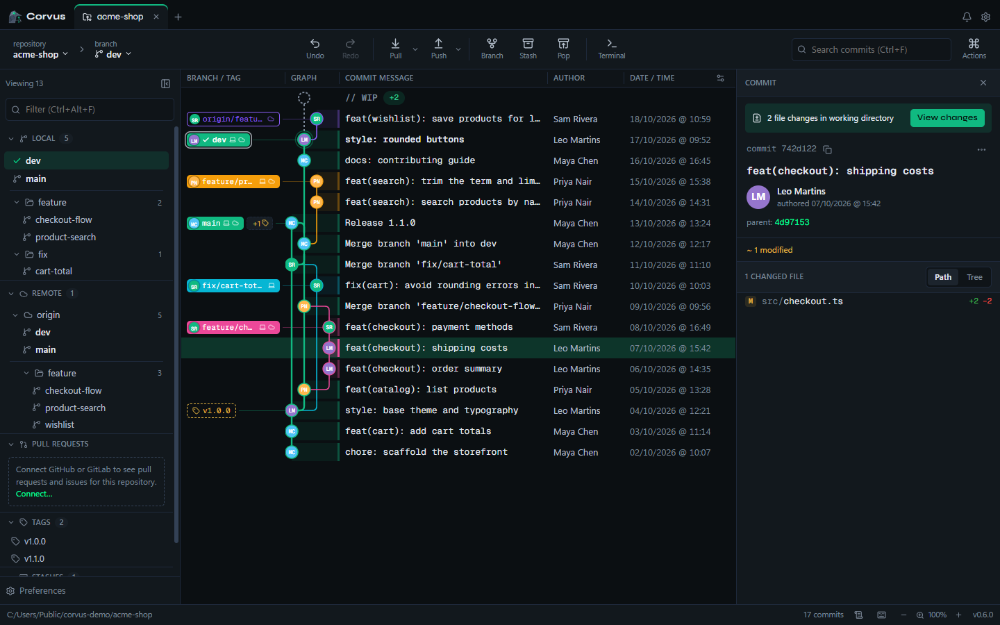
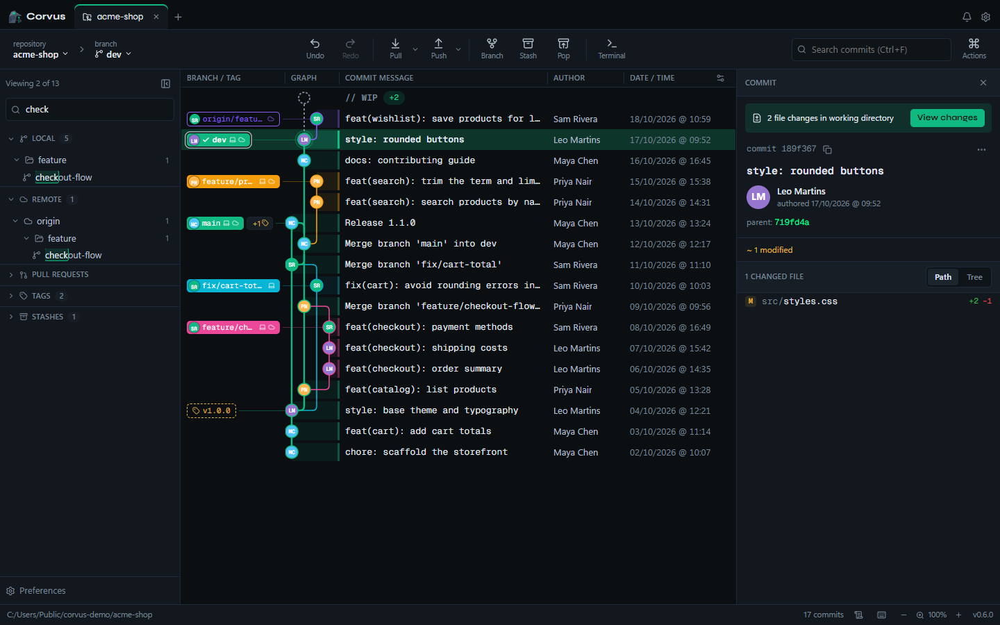
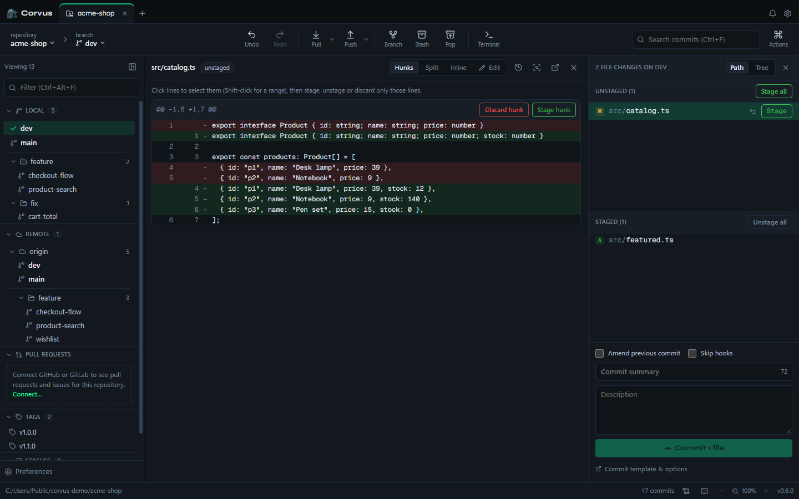
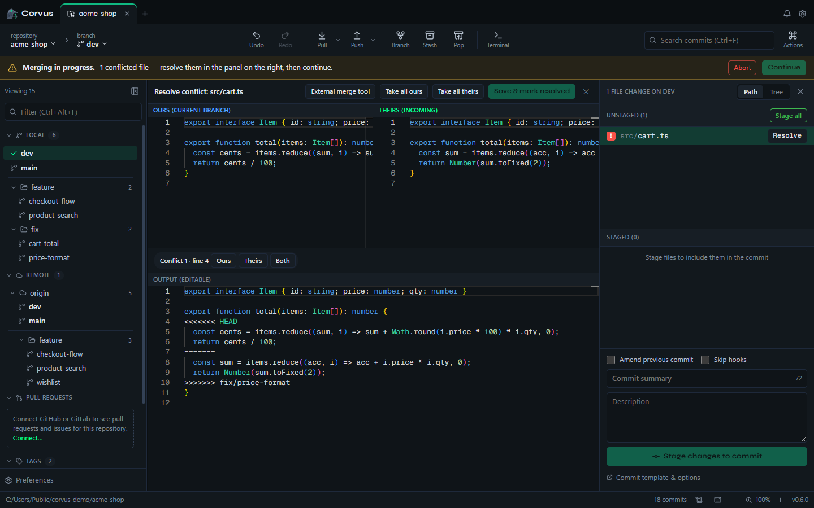
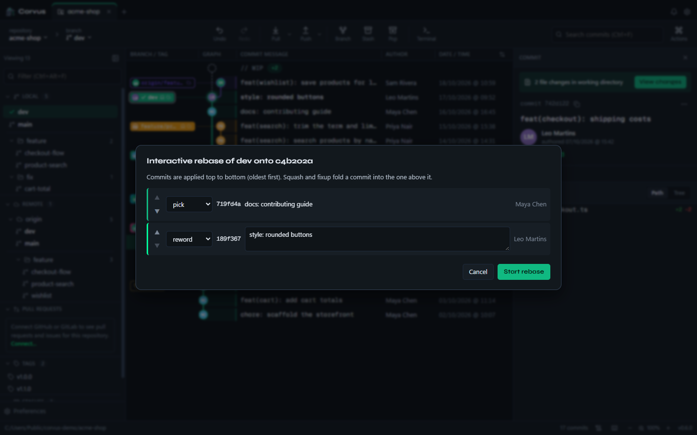
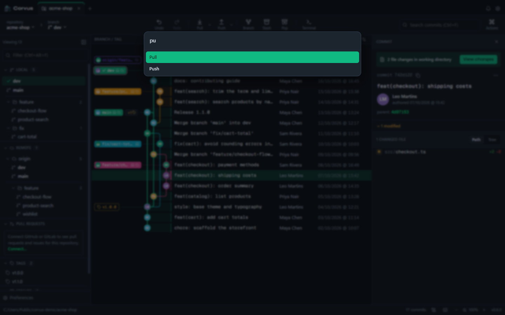
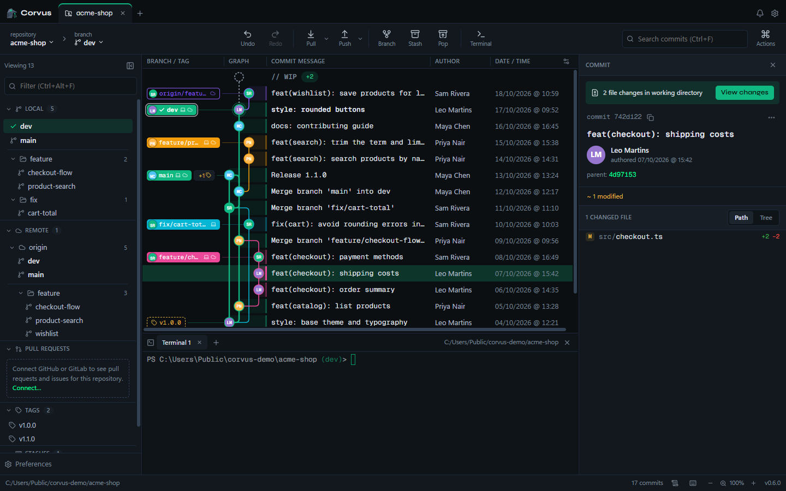

<p align="center">
  
</p>

<h1 align="center">Corvus</h1>

<p align="center">A fast, friendly desktop Git client for Windows, macOS and Linux.</p>

<p align="center">
  <a href="https://schuuulz.github.io/corvus/"><strong>Download</strong></a> ·
  <a href="../../releases/latest">Release notes</a> ·
  <a href="#for-developers">Contribute</a>
</p>

<p align="center">
  <a href="../../releases/latest"></a>
  <a href="../../actions/workflows/ci.yml"></a>
</p>

<p align="center">
  
</p>

Corvus is an open-source Git client built with Tauri, Rust and React. It is small, starts fast, and puts the everyday work of a repository a click away: reading history, staging precisely, switching branches, resolving conflicts and reviewing pull requests. It is a clean-room project: all code, visuals and assets are original.

## Download

Get it from the **[download page](https://schuuulz.github.io/corvus/)**, which picks the right installer for your computer, or from the **[latest release](../../releases/latest)**:

| System | Installer |
| --- | --- |
| Windows 10/11 | `Corvus_<version>_x64-setup.exe` (or `.msi`) |
| macOS, Apple Silicon | `Corvus_<version>_aarch64.dmg` |
| macOS, Intel | `Corvus_<version>_x64.dmg` |
| Linux | `.AppImage` (updates itself), `.deb` or `.rpm` |

Corvus needs [Git](https://git-scm.com/downloads) installed (2.40 or newer recommended).

**Updates.** On launch Corvus checks for a newer version and asks before installing it. Choose *Later* and a **Restart to update** button waits in the status bar. Updates are signed and verified before they install. On Linux, the `.AppImage` updates itself; `.deb` and `.rpm` installs tell you a new version is out.

<details>
<summary><strong>Installing an unsigned build</strong></summary>

Code signing is being set up (see [docs/SIGNING.md](docs/SIGNING.md)). Until then, browsers and operating systems may warn about the installers:

- **Browser download warning:** choose *Keep* (Chrome: *⋯ › Keep*; Edge: *⋯ › Keep › Keep anyway*).
- **Windows SmartScreen** ("Windows protected your PC"): choose *More info › Run anyway*.
- **Microsoft Defender flags or removes the file:** this is a false positive on an unsigned build. Restore it from *Windows Security › Protection history › Actions › Restore*, and please report it at [Microsoft's file submission page](https://www.microsoft.com/wdsi/filesubmission).
- **macOS** ("Apple could not verify…"): open the app once, then choose *Open Anyway* in *System Settings › Privacy & Security*, or run `xattr -cr "/Applications/Corvus.app"`.

To check that a download is intact, compare it with `SHA256SUMS.txt` from the same release:

```bash
sha256sum -c SHA256SUMS.txt --ignore-missing            # Linux
shasum -a 256 -c SHA256SUMS.txt --ignore-missing        # macOS
Get-FileHash .\Corvus_*-setup.exe -Algorithm SHA256     # Windows (PowerShell)
```

</details>

## Highlights

### Read history at a glance

The commit graph keeps the main branches in fixed columns, so feature work branches off them visibly. The branch panel puts `dev` and `main` on top, groups the rest into folders (`feature/`, `fix/`…), shows which remote branches you already track, and filters as you type.



### Stage exactly what you mean

Stage, unstage or discard whole files, single hunks or individual lines, and edit a file right in the diff.



### Switch branches without losing work

Switching branches brings your uncommitted changes along, with staged changes still staged. If they would conflict with the other branch, Corvus switches anyway and keeps them in a named stash, telling you which files collide. Nothing is lost along the way.

### Resolve conflicts in place

A 3-way merge editor shows yours, theirs and the result side by side, with per-conflict choices, or hands the file to your external merge tool.



### Rewrite history safely

Interactive rebase lets you reorder, squash, fixup, reword or drop commits, and undo/redo is there when you change your mind.



### Keep your hands on the keyboard

A command palette (<kbd>Ctrl</kbd>+<kbd>P</kbd>) runs any action, and an in-app terminal opens in the repository.

 

## Features

- **Graph:**
  - pinned main branches;
  - per-repository column widths (double-click a column edge to fit its content);
  - search;
  - hover highlights;
  - one-click branch switching.
- **Working tree:**
  - file, hunk and line staging;
  - amend;
  - commit templates;
  - skip hooks;
  - discard;
  - stash, pop and apply.
- **History:**
  - merge, rebase, cherry-pick, revert and reset;
  - interactive rebase;
  - undo and redo;
  - file history and blame.
- **Branches:**
  - auto-stash when switching;
  - tracking branches from remotes;
  - Gitflow (feature, release and hotfix) from the side panel.
- **Conflicts:**
  - 3-way merge editor or external merge tool;
  - proactive conflict prediction against the base branch.
- **Remotes:**
  - fetch;
  - pull (fast-forward if possible, fast-forward only, or rebase);
  - push and force-push with lease;
  - auto-fetch.
- **Integrations:** GitHub, GitHub Enterprise, GitLab and GitLab Self-Managed, with:
  - pull requests and issues in the side panel;
  - creating pull requests;
  - SSH key upload.
- **Tools:**
  - in-app terminal;
  - external editor, terminal and merge tool;
  - command palette;
  - activity log.
- **Preferences:**
  - themes;
  - date formats;
  - SSH keys and commit signing (GPG/SSH);
  - Git LFS;
  - sparse checkout;
  - English and Brazilian Portuguese.

## Privacy and security

Corvus has **no telemetry and no account**. It only talks to the network for:

| What | When |
| --- | --- |
| GitHub Releases (update check) | on launch |
| Your Git remotes | fetch, pull, push, clone, and auto-fetch (every minute by default; set 0 to turn it off) |
| GitHub / GitLab APIs | only for integrations you connect |
| Gravatar / GitHub avatars | only if you turn on *Show avatars* (off by default) |

Integration tokens are kept in your operating system's keychain. They are given to Git **only for network operations**, and only for the host they belong to, so hooks and tools run by other Git commands never see them. The app runs with a strict Content Security Policy. When it edits, shows or resolves a file, it stays inside the repository and never follows a symbolic link out of it.

Found a security issue? Please report it privately to the maintainer instead of opening a public issue.

## For developers

### Run it

Requirements: Node.js 22+, Rust (stable) and Git. On Linux, also `libwebkit2gtk-4.1-dev libappindicator3-dev librsvg2-dev patchelf libssl-dev pkg-config`.

```bash
npm ci
npm run tauri dev            # the app with hot reload
```

Before opening a pull request:

```bash
npx tsc --noEmit             # type-check the UI
npm run build                # build the UI
cd src-tauri && cargo test   # backend unit and integration tests (throwaway repos)
```

### How it is built

```
src/                 React + TypeScript UI
  api.ts             typed calls to the backend, mirroring the Rust structs
  actions.ts         user actions and their feedback (run(..., { success, error }))
  store.ts           shared state (zustand) and settings (useG / useR)
  components/        UI, one component per thing it shows
src-tauri/           Rust backend (Tauri 2)
  src/git/           git2 for reads; the git CLI for writes and network (cli.rs)
  src/git/outcome.rs structured results (OpOutcome) instead of text for the UI to parse
  src/integrations.rs GitHub/GitLab APIs
  tests/git_ops.rs   integration tests against temporary repositories
site/                the download page (GitHub Pages)
```

The rules every change follows (code quality, types, feedback, security) are in [CLAUDE.md](CLAUDE.md).

### Branches, commits and releases

- Work on a `feat/…`, `fix/…`, `docs/…`, `chore/…` or `refactor/…` branch off **`dev`**, and open the pull request against `dev`.
- `main` holds released code. It only receives pull requests from `dev`, merged with a **merge commit**.
- Commit messages and pull request titles follow [Conventional Commits](https://www.conventionalcommits.org/):
  - `feat:` releases a minor version;
  - `fix:` and `perf:` release a patch;
  - `feat!:` or a `BREAKING CHANGE:` footer marks a breaking change.
- [release-please](https://github.com/googleapis/release-please) turns those commits into a "chore(main): release x.y.z" pull request. Merging it:
  1. tags `corvus-vX.Y.Z`;
  2. builds the installers for Windows, Linux and macOS (Apple Silicon and Intel) with `SHA256SUMS.txt` and the updater manifest;
  3. syncs `main` back into `dev`.
- Never edit versions or tags by hand.

### CI

- Every pull request runs a secret scan (gitleaks).
- Pull requests into `main` and pushes to `main` also run:
  - the type-check;
  - the UI build;
  - the Rust tests on Linux and Windows.
- Signing for installers and updates is described in [docs/SIGNING.md](docs/SIGNING.md).

## License

[MIT](LICENSE).
