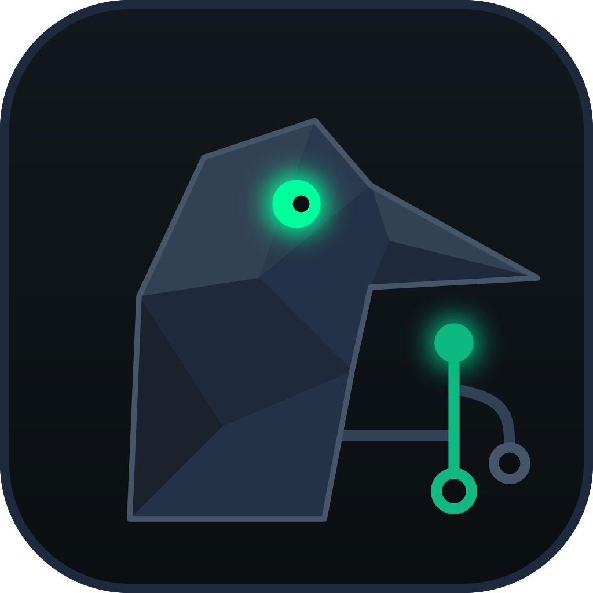

<p align="center">
  
</p>

<h1 align="center">Corvus</h1>

<p align="center">A fast, friendly desktop Git client for Windows, Linux and macOS.</p>

---

Corvus is a graphical Git client built with **Tauri 2**, **Rust** and **React**. It is an independent, clean-room project: all code, visuals and assets are original.

## Features

- **Commit graph:** main branches pinned to fixed columns, right-angle lines, author avatars, local and remote branches grouped, one-click branch switching (including from the "+N" menu).
- **Working tree:** stage, unstage or discard whole files, hunks or single lines; amend; commit templates; skip hooks.
- **History:**
  - merge, rebase, cherry-pick, revert, reset;
  - interactive rebase (reorder, squash, fixup, reword, drop);
  - undo and redo.
- **Conflicts:** a 3-way merge editor, plus an external merge tool if you prefer one.
- **Remotes:** fetch, pull (fast-forward if possible, fast-forward only or rebase), push or force-push with lease, and auto-fetch.
- **Gitflow:** start and finish feature, release and hotfix branches from the main branches in the side panel.
- **Integrations:** GitHub, GitHub Enterprise, GitLab and GitLab Self-Managed through personal access tokens stored in your OS keychain, with pull requests, issues and SSH key upload.
- **Tooling:**
  - an in-app terminal;
  - external editor, terminal and merge tool;
  - file history and blame;
  - command palette;
  - activity log.
- **Preferences:**
  - themes, date formats, editor and terminal settings;
  - SSH and commit signing (GPG/SSH);
  - LFS and sparse checkout;
  - conflict prediction;
  - English and Portuguese (Brazil) feedback messages.

## Download

Get the latest installer from **[Releases](../../releases/latest)**:

| OS | Files |
| --- | --- |
| Windows | `.msi` or `-setup.exe` |
| Linux | `.deb`, `.rpm` or `.AppImage` |
| macOS | `.dmg` (Apple Silicon `aarch64` or Intel `x64`) |

Once installed, Corvus keeps itself up to date: on launch it installs any newer release and restarts. On Linux this needs the `.AppImage`; with `.deb` or `.rpm` it tells you a new version is out.

### Installing an unsigned build

Code signing is being set up (see [docs/SIGNING.md](docs/SIGNING.md)). Until then, browsers and operating systems may warn about the installers:

- **Browser download warning:** choose *Keep* (Chrome: *⋯ › Keep*; Edge: *⋯ › Keep › Keep anyway*).
- **Windows SmartScreen** ("Windows protected your PC"): choose *More info › Run anyway*.
- **Microsoft Defender flags or removes the file:** this is a false positive on an unsigned build.
  - To restore the file, go to *Windows Security › Protection history*, then *Actions › Restore*.
  - Please also report it at [Microsoft's file submission page](https://www.microsoft.com/wdsi/filesubmission) ("Incorrectly detected as malware").
- **macOS** ("Apple could not verify…"): open the app once, then go to *System Settings › Privacy & Security* and choose *Open Anyway*. Alternatively, run `xattr -cr "/Applications/Corvus.app"`.

To check that a download is intact, compare its hash with `SHA256SUMS.txt` from the same release:

```bash
sha256sum -c SHA256SUMS.txt --ignore-missing            # Linux
shasum -a 256 -c SHA256SUMS.txt --ignore-missing        # macOS
Get-FileHash .\Corvus_*-setup.exe -Algorithm SHA256     # Windows (PowerShell)
```

## Development

Requirements:
- Node.js 22+
- Rust (stable)
- Git
- On Linux: `libwebkit2gtk-4.1-dev libappindicator3-dev librsvg2-dev patchelf libssl-dev pkg-config`

```bash
npm install
npm run tauri dev        # run the app with hot reload
npx tsc --noEmit         # type-check the frontend
cd src-tauri && cargo test   # backend tests (uses throwaway git repos)
```

Project layout:

```
src/          React + TypeScript UI
src-tauri/    Rust backend (git2 for reads, git CLI for writes and network)
.github/      CI and release workflows
```

## Branches and releases

- **`dev`:** day-to-day work. Open pull requests against `dev`.
- **`main`:** released code. Changes reach it through a pull request from `dev`.

Commit messages follow **[Conventional Commits](https://www.conventionalcommits.org/)**:
- `feat:` adds a feature (minor bump);
- `fix:` fixes a bug (patch bump);
- `feat!:` or a `BREAKING CHANGE:` footer marks a breaking change.

Versioning is automated with [release-please](https://github.com/googleapis/release-please):

1. Pushes to `main` keep a **"chore(main): release x.y.z"** pull request up to date. It bumps the version in `package.json`, `src-tauri/tauri.conf.json` and `src-tauri/Cargo.toml`, and updates `CHANGELOG.md`.
2. Merging that pull request tags `vX.Y.Z` and publishes a GitHub Release.
3. The release workflow builds the installers for Windows, Linux and macOS (arm64 and x64) and attaches them to the release.

Every push and pull request also runs CI: a secret scan with gitleaks, a type-check, the frontend build, and the Rust tests on Linux and Windows.
